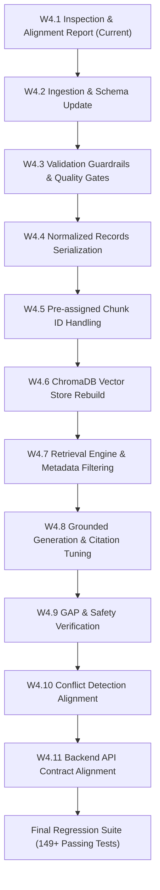

# WEEK 4 — TASK W4.1: REGULATORY CORPUS ALIGNMENT & IMPACT INSPECTION REPORT

**Project:** ABC Shield / FinRegTech ShipYard  
**Role:** Padma Kumar — AI/RAG & Conflict Detection Engineer  
**Date:** 29 September 2026  
**Inspection Type:** Strictly Read-Only Regulatory Corpus & Pipeline Alignment  
**Baseline Test Suite:** 149/149 Passing Tests  

---

## 1. Executive Summary

This inspection report executes **Task W4.1 (Regulatory Corpus Alignment & Impact Inspection)** for the ABC Shield / FinRegTech ShipYard AI/RAG prototype. In accordance with project instructions, this task is **STRICTLY READ-ONLY**: zero production code files, raw workbooks, processed JSON artifacts, vector stores, or unit tests were modified during this inspection.

Madhesh has delivered two enhanced regulatory workbooks:
1. `data/raw/ABC_Shield_Source_Register_Reviewed (1).xlsx` (13,192 bytes)
2. `data/raw/ABC_Shield_RAG_Ready_Regulatory_Knowledge.xlsx` (24,781 bytes)

These new workbooks have been systematically compared against the existing Week 3 baseline:
- `data/raw/ABC shield_Data Dictionary.xlsx` (10,096 bytes)
- `data/raw/ABC_Shield_Regulatory_Records_15_with_Conflict_Overlap.xlsx` (15,295 bytes)
- `data/raw/ABC_Shield_Source_Register (1).xlsx` (8,598 bytes)
- `data/processed/normalized_regulatory_records.json` (15 normalized records)
- `data/processed/regulatory_chunks.json` (15 regulatory chunks)
- ChromaDB Vector Store (`data/processed/chroma_db`, collection `regulatory_records`, 15 vectors)
- Complete Tasks 2–11 codebase (149 passing unit, integration, and safety tests)

### Key Alignment Findings

1. **Perfect Entity & Identifier Continuity:**
   - The corpus continues to comprise exactly **15 regulatory records** (`RR-UK-01` through `RR-UK-09`, `RR-EU-01` through `RR-EU-06`) and **15 regulatory sources** (`UK-01` through `UK-09`, `EU-01` through `EU-06`).
   - All 15 Record IDs, Source IDs, and foreign-key linkages between records and sources are 100% identical to the Week 3 corpus. There are **zero orphaned records, zero invalid foreign keys, and zero duplicate IDs**.

2. **Zero Semantic Loss in Overlapping Data:**
   - In all overlapping fields (`Record_ID`, `Source_ID`, `Regulation_Name`, `Jurisdiction`, `Issuing_Authority`, `Section_Article`, `Title`, `Requirement`, `Applicability`, `Version_Date`, `Effective_Date`, `Validation_Status`, `Relevance_to_Project`, `Notes_Limitations`), there is **100% verbatim agreement** between the old `Regulatory Records` sheet and the new `RAG_Records` sheet.

3. **Validation & Approval Integrity Preserved:**
   - **All 15 records and all 15 sources remain strictly in `"Candidate - Awaiting Approval"` status.**
   - Approved count = **0**, Candidate count = **15**.
   - No records have been promoted to approved status. The validation gate (`is_approved_for_rag = False`) remains fully intact.

4. **Substantial Upstream RAG Enrichment:**
   - Madhesh has introduced high-value, RAG-specific fields directly into `ABC_Shield_RAG_Ready_Regulatory_Knowledge.xlsx`:
     - `Chunk_ID`: Pre-assigned upstream (`RR-UK-01-C01` through `RR-EU-06-C01`), matching our existing chunking convention.
     - `Retrieval_Text`: Pre-composed, contextualized evidence blocks combining Source, Reference, Topic, Requirement, and Applicability.
     - `Retrieval_Tags`: Semicolon-delimited keyword tags optimized for hybrid search.
     - `Citation_Label`: Canonical citation strings (e.g., `UK-01 | Bribery Act 2010 | Section 1`).
     - `Retrieval_Priority`: Extraction-planning and retrieval priorities (`P1 Core candidate`, `P2 Conditional`, `P3 Supporting / Conditional`, `P4 Deferred`, `P4 Watchlist`).
     - `Authority_Rule`: Explicit legal hierarchy and bindingness guidance per record.
     - `RAG_Instruction`: Standardized generation instructions emphasizing official citations and non-fabrication.
     - `Official_Source_Check_Note`: Line-item official source verification audit notes.

5. **Identical Conflict Overlap Dataset:**
   - The new `Conflict_Handling` worksheet contains the exact same **11 documented conflict/overlap pairs** (`CO-001` through `CO-011`) across the exact same 13 columns as the old `Conflict Overlap` worksheet. Content matches byte-for-byte.

6. **ChromaDB State:**
   - ChromaDB currently contains 15 vectors generated from the raw `Requirement` paraphrase text with `all-MiniLM-L6-v2` embeddings (384 dimensions). It was **not touched or reindexed**.

---

## 2. New Workbook Inventory

### Workbook 1: `ABC_Shield_Source_Register_Reviewed (1).xlsx`
- **File Path:** `data/raw/ABC_Shield_Source_Register_Reviewed (1).xlsx`
- **File Size:** 13,192 bytes
- **Total Worksheets:** 2

#### Sheet 1: `Source Register`
- **Dimensions:** 16 rows × 22 columns (1 header row + 15 data rows).
- **Exact Headers:**
  1. `Source ID`
  2. `Source Name`
  3. `Issuing Authority`
  4. `Jurisdiction`
  5. `Source Type`
  6. `Authority Level`
  7. `Publication/Effective Date` (legacy combined field retained for traceability)
  8. `Version/Last Updated`
  9. `Official Link/Reference`
  10. `Topic`
  11. `Status`
  12. `Approval/Validator`
  13. `Notes/Limitations`
  14. `Adoption Date` *(New)*
  15. `Publication Date` *(New)*
  16. `Effective Date` *(New structured field)*
  17. `ABC Shield Relevance / In-Scope Rationale` *(New)*
  18. `Extraction Priority` *(New)*
  19. `Legal / Regulatory Effect (screening only)` *(New)*
  20. `SME Decision Date / Comments` *(New)*
  21. `Last Checked` *(New)*
  22. `Source Verification / QA Note` *(New)*
- **Unique Identifiers:** `Source ID` (`UK-01` to `UK-09`, `EU-01` to `EU-06`). All 15 are unique.
- **Validation/Approval Fields:**
  - `Status`: 15/15 rows contain `"Candidate – Awaiting Approval"`.
  - `Approval/Validator`: 15/15 rows are empty/null (awaiting SME review).
  - `SME Decision Date / Comments`: 15/15 rows are empty/null.
- **Sample Records:**
  - `UK-01`: *Bribery Act 2010* | Authority: UK Parliament / legislation.gov.uk | Level: A | Status: Candidate – Awaiting Approval | Pri: P1 – Core | Last Checked: 2026-09-24.
  - `EU-01`: *Directive (EU) 2026/1021 on combatting corruption* | Authority: European Parliament and Council | Level: A | Status: Candidate – Awaiting Approval | Pri: P1 – Core candidate; applicability review required | Adopted: 29 April 2026 | Published: 11 May 2026 | Effective: 31 May 2026.

#### Sheet 2: `Review Notes`
- **Dimensions:** 11 rows × 2 columns (1 header row `['Review date', '24 September 2026']` + 10 note rows).
- **Purpose:** Documents Madhesh's source review methodology, screening caveats, and RAG governance principles:
  1. *Purpose:* Preliminary relevance screening; not legal advice or SME approval.
  2. *Important control:* All records remain Candidate – Awaiting Approval. No source promoted.
  3. *Scope limitation:* FCA sources conditional on regulated perimeter; OLAF/public-sector sources conditional.
  4. *Date handling:* Separated Adoption, Publication, and Effective dates. `—` denotes unestablished date.
  5. *Verification standard:* Official-source pages checked for selected key records.
  6. *EU-01 critical note:* Directive (EU) 2026/1021 verified on EUR-Lex (Adopted 29 Apr 2026, OJ 11 May 2026, Force 31 May 2026). Member State transposition separate.
  7. *Priority meaning:* P1 Core candidate, P2 Conditional, P3 Supporting/conditional, P4 Deferred/watchlist. Extraction aid only.
  8. *Legal effect caveat:* Screening-level description only.
  9. *Suggested approval workflow:* 4-step controlled workflow.
  10. *Data-quality improvement:* Retained legacy date column; new separated date fields are primary.

---

### Workbook 2: `ABC_Shield_RAG_Ready_Regulatory_Knowledge.xlsx`
- **File Path:** `data/raw/ABC_Shield_RAG_Ready_Regulatory_Knowledge.xlsx`
- **File Size:** 24,781 bytes
- **Total Worksheets:** 6

#### Sheet 1: `RAG_Records`
- **Dimensions:** 16 rows × 25 columns (1 header row + 15 data rows).
- **Exact Headers:**
  1. `Chunk_ID` *(New)*
  2. `Record_ID`
  3. `Source_ID`
  4. `Regulation_Name`
  5. `Section_Article`
  6. `Title`
  7. `Jurisdiction`
  8. `Issuing_Authority`
  9. `Authority_Level` *(New on record sheet)*
  10. `Content_Type` *(New)*
  11. `Requirement`
  12. `Applicability`
  13. `Relevance_to_Project`
  14. `Version_Date`
  15. `Effective_Date`
  16. `Official_Source_URL` *(Renamed from Source_URL)*
  17. `Validation_Status`
  18. `Notes_Limitations`
  19. `Retrieval_Text` *(New)*
  20. `Retrieval_Tags` *(New)*
  21. `Citation_Label` *(New)*
  22. `Retrieval_Priority` *(New)*
  23. `Authority_Rule` *(New)*
  24. `RAG_Instruction` *(New)*
  25. `Official_Source_Check_Note` *(New)*
- **Data Counts:** 15 populated records (9 UK, 6 EU).
- **Validation Status:** 15/15 rows are `"Candidate - Awaiting Approval"`.

#### Sheet 2: `Source_Control`
- **Dimensions:** 16 rows × 14 columns (1 header row + 15 data rows).
- **Exact Headers:** `['Source ID', 'Source Name', 'Jurisdiction', 'Source Type', 'Authority Level', 'Topic', 'Status', 'Extraction Priority', 'Official Link/Reference', 'ABC Shield Relevance / In-Scope Rationale', 'Legal / Regulatory Effect (screening only)', 'Notes/Limitations', 'RAG_Use', 'Approval_Gate']`
- **Purpose:** Source-level operational governance specifying `RAG_Use` (e.g. "Primary/binding source: preferred for legal requirement retrieval") and enforcing `Approval_Gate` ("Candidate – Awaiting Approval").

#### Sheet 3: `RAG_Rules`
- **Dimensions:** 11 rows × 4 columns (1 header row + 10 data rows).
- **Exact Headers:** `['Rule_ID', 'Rule_Type', 'RAG_Rule', 'Implementation_Note']`
- **Documented Rules:**
  - `RAG-01` (Source priority): Prefer Authority Level A when answering binding legal requirements.
  - `RAG-02` (Guidance separation): Use Level B/C/D as guidance/context; do not present as statute.
  - `RAG-03` (Citation): Every regulatory answer must retain Source_ID + Section/Article + official URL.
  - `RAG-04` (Validation gate): Candidate records must not be represented as SME-approved requirements.
  - `RAG-05` (Applicability): Check jurisdiction, entity scope, and applicability before presenting retrieval.
  - `RAG-06` (Version control): Prefer official version/date; flag uncertainty; do not silently merge versions.
  - `RAG-07` (No-source case): If no reliable approved source is retrieved, return source-not-found/validation-needed state.
  - `RAG-08` (Conflict handling): Retrieve higher-authority requirement first; use lower-authority as context.
  - `RAG-09` (Human decision): RAG output is evidence for review; human/SME makes final compliance decision.
  - `RAG-10` (Scope boundary): Corpus is UK + EU anti-bribery/corruption; do not infer full member state laws.

#### Sheet 4: `Field_Mapping`
- **Dimensions:** 18 rows × 3 columns (1 header row + 17 data rows).
- **Exact Headers:** `['Data_Dictionary_Field', 'Purpose', 'RAG_Use']`
- **Purpose:** Maps the 17 fields from the original Data Dictionary to their functional RAG purpose.

#### Sheet 5: `Conflict_Handling`
- **Dimensions:** 12 rows × 13 columns (1 header row + 11 data rows).
- **Exact Headers:** `['Conflict_ID', 'Topic', 'Source_ID_1', 'Source_1', 'Source_ID_2', 'Source_2', 'Relationship', 'Requirement_Comparison', 'Scope_Difference', 'Authority_Difference', 'Version_Effective_Date_Difference', 'Conflict_Status', 'RAG_Use']`
- **Content:** Identical to old `Conflict Overlap` worksheet (11 documented pairs `CO-001` through `CO-011`).

#### Sheet 6: `Official_Verification`
- **Dimensions:** 6 rows × 6 columns (1 header row + 5 data rows).
- **Exact Headers:** `['Source_ID', 'Source_Name', 'Official_Origin', 'Verification', 'Official_URL', 'Verification_Note']`
- **Verified Sources:** Documents official verification status for `UK-01`, `UK-02`, `UK-03`, `EU-01`, and `EU-02`.

---

## 3. Old Workbook Inventory

### 1. `ABC shield_Data Dictionary.xlsx`
- **File Path:** `data/raw/ABC shield_Data Dictionary.xlsx` (10,096 bytes)
- **Worksheet:** `Sheet1` (17 data rows × 4 columns: `Field Name`, `Description`, `Example`, `Required?`).
- **Required Fields:** `Record_ID`, `Source_ID`, `Regulation_Name`, `Jurisdiction`, `Issuing_Authority`, `Section_Article`, `Title`, `Requirement`, `Validation_Status`.

### 2. `ABC_Shield_Regulatory_Records_15_with_Conflict_Overlap.xlsx`
- **File Path:** `data/raw/ABC_Shield_Regulatory_Records_15_with_Conflict_Overlap.xlsx` (15,295 bytes)
- **Worksheets:**
  - `Regulatory Records` (15 data rows × 15 columns)
  - `Validation Notes` (5 data rows × 2 columns)
  - `Conflict Overlap` (11 data rows × 13 columns)
  - `Conflict Overlap Guide` (6 data rows × 2 columns)

### 3. `ABC_Shield_Source_Register (1).xlsx`
- **File Path:** `data/raw/ABC_Shield_Source_Register (1).xlsx` (8,598 bytes)
- **Worksheet:** `Source Register` (15 data rows × 13 columns: `Source ID`, `Source Name`, `Issuing Authority`, `Jurisdiction`, `Source Type`, `Authority Level`, `Publication/Effective Date`, `Version/Last Updated`, `Official Link/Reference`, `Topic`, `Status`, `Approval/Validator`, `Notes/Limitations`).

### 4. Processed Artifacts
- `data/processed/normalized_regulatory_records.json`: 15 JSON records resulting from metadata join of `Regulatory Records` and `Source Register`.
- `data/processed/regulatory_chunks.json`: 15 chunk objects (`RR-UK-01-C01` to `RR-EU-06-C01`).
- `data/processed/chroma_db`: Persistent ChromaDB storage containing collection `regulatory_records` (15 vectors, `all-MiniLM-L6-v2`, dim 384).

---

## 4. Old vs New Schema Comparison

The following table provides the comprehensive field-by-field mapping between the Week 3 schema and the new Week 4 workbooks.

| Old Field Name | New Field Name | Status | Code Impact | Required Action in W4.2+ |
| :--- | :--- | :--- | :--- | :--- |
| **Record_ID** | `Record_ID` | SAME | Ingestion schemas, tests, joins | Retain as primary record identifier |
| **Source_ID** | `Source_ID` | SAME | Ingestion schemas, joins, conflicts | Retain as primary foreign key to sources |
| **Regulation_Name** | `Regulation_Name` | SAME | Schemas, citations, prompts | Retain; alias to `regulation` in code |
| **Issuing_Authority** | `Issuing_Authority` | SAME | Schemas, citations, normalizer | Retain; alias to `regulator` in code |
| **Jurisdiction** | `Jurisdiction` | SAME | Metadata filtering in retriever | Retain; values remain `UK` and `EU` |
| **Section_Article** | `Section_Article` | SAME | Schemas, citations, retriever | Retain; exact legal provision pointer |
| **Title** | `Title` | SAME | Schemas, retrieval metadata | Retain; provision title header |
| **Requirement** | `Requirement` | SAME | Chunker, schemas, citations | Retain; paraphrased requirement summary |
| **Regulatory_Text** | `Regulatory_Text` | SAME (Null) | Chunker, normalizer, validator | Keep distinct from paraphrase; remains null |
| **Summary** | `Summary` | SAME (Optional) | Schemas | Retain optional field |
| **Topic** | `Topic` | SAME | Schemas, retriever metadata | Retain; joined from source register |
| **Applicability** | `Applicability` | SAME | Normalizer, schemas | Retain; entity/territorial applicability |
| **Relevance_to_Project** | `Relevance_to_Project` | SAME | Schemas, normalizer | Retain; project scope rationale |
| **Notes_Limitations** | `Notes_Limitations` | SAME | Schemas, normalizer | Retain; record-level caveats |
| **Source_URL** | `Official_Source_URL` | RENAMED | `excel_loader.py`, `normalizer.py` | Update loader to read `Official_Source_URL` with fallback to `Source_URL` |
| **Version_Date** | `Version_Date` | SAME | Schemas, retriever metadata | Retain; version timestamp |
| **Effective_Date** | `Effective_Date` | SAME | Schemas, retriever metadata | Retain; effective publication date |
| **Validation_Status** | `Validation_Status` | SAME | Gating, validator, retriever | Retain; hard gate for RAG approval |
| **Approval/Validator** | `Approval/Validator` | SAME | Source register schema | Retain; remains unpopulated (null) |
| **Authority Level** | `Authority_Level` | CHANGED (Location) | Normalizer, schemas | Now present in both `RAG_Records` and `Source Register Reviewed` |
| **Source Type** | `Source_Type` / `Content_Type` | CHANGED | Schemas, normalizer | `Content_Type` added to `RAG_Records`; `Source Type` in Source Register |
| *(None)* | `Chunk_ID` | **NEW** | Chunker, schemas | Upstream pre-assigned chunk IDs match current pattern (`-C01`) |
| *(None)* | `Retrieval_Text` | **NEW** | Chunker, vector store, retriever | Context-rich text block for embedding and retrieval |
| *(None)* | `Retrieval_Tags` | **NEW** | Chunker, vector store metadata | Store as searchable metadata / hybrid search tags |
| *(None)* | `Citation_Label` | **NEW** | `citations.py`, schemas | Standardized citation label string from upstream |
| *(None)* | `Retrieval_Priority` | **NEW** | Retriever ranking, schemas | Store priority (`P1` to `P4`) in chunk metadata |
| *(None)* | `Authority_Rule` | **NEW** | Prompts, retriever metadata | Legal hierarchy context for prompt and metadata |
| *(None)* | `RAG_Instruction` | **NEW** | `prompts.py`, schemas | Standardized generation instruction for context |
| *(None)* | `Official_Source_Check_Note`| **NEW** | Provenance schemas | Official source verification notes for audit |
| *(None)* | `Adoption Date` | **NEW** | Source register schema | Separated adoption date in Source Register |
| *(None)* | `Publication Date` | **NEW** | Source register schema | Separated publication date in Source Register |
| *(None)* | `Legal / Regulatory Effect` | **NEW** | Source register schema | Preliminary legal effect screening note |
| *(None)* | `Extraction Priority` | **NEW** | Source register schema | Source-level extraction planning priority |
| *(None)* | `Last Checked` | **NEW** | Source register schema | Audit date stamp (e.g. `2026-09-24`) |
| *(None)* | `Source Verification / QA` | **NEW** | Source register schema | Verification QA comments from reviewer |

---

## 5. New RAG Fields Analysis

The workbook `ABC_Shield_RAG_Ready_Regulatory_Knowledge.xlsx` introduces several dedicated RAG-engineering fields. Each field was inspected and evaluated across the pipeline stages:

### 1. `Chunk_ID`
- **Workbook Content:** 15/15 populated. Values: `RR-UK-01-C01` through `RR-UK-09-C01`, `RR-EU-01-C01` through `RR-EU-06-C01`.
- **Meaning:** Pre-computed chunk identifier assigned directly upstream by the data author.
- **Pipeline Impact:**
  - *Ingestion:* Store directly on the record.
  - *Chunking:* Eliminates the need to synthesize artificial chunk IDs when records are 1:1. The chunker can validate against or adopt the upstream `Chunk_ID`.
  - *Retrieval / Citations:* Replaces dynamically generated IDs with the upstream canonical ID.

### 2. `Retrieval_Text`
- **Workbook Content:** 15/15 populated. Lengths range from 343 to 720 characters.
- **Example Value (`RR-UK-01`):**
  > `Source: Bribery Act 2010 | Reference: Section 1 | Topic: Offences of bribing another person | Requirement: It is an offence to offer, promise or give a financial or other advantage to another person intending to induce or reward improper performance of a relevant function or activity. | Applicability: General criminal law applying to individuals and commercial organisations subject to UK jurisdiction.`
- **Meaning:** A pre-engineered, highly structured text representation containing source name, section, topic, requirement paraphrase, and applicability scope.
- **Pipeline Impact:**
  - *Ingestion:* Ingest as a dedicated field on `NormalizedRegulatoryRecord`.
  - *Chunking:* Can serve as the primary chunk text for embedding, while preserving raw `Requirement` as a distinct field.
  - *Retrieval:* Enhances vector search precision because the embedding captures both the provision name and applicability rather than just paraphrased requirement prose.
  - *Generation:* Provides richer, self-contained evidence blocks to the LLM.

### 3. `Retrieval_Tags`
- **Workbook Content:** 15/15 populated. Semicolon-delimited keywords.
- **Example Value (`RR-UK-01`):** `UK; Bribery Act 2010; Offences of bribing another person; Section 1`
- **Meaning:** Controlled terminology and alias tags for keywords, statutes, and provisions.
- **Pipeline Impact:**
  - *Ingestion / Chunking:* Store as list or delimited string in chunk metadata.
  - *Retrieval:* Enables lexical/tag filtering or keyword matching alongside vector similarity.

### 4. `Citation_Label`
- **Workbook Content:** 15/15 populated.
- **Example Value (`RR-UK-01`):** `UK-01 | Bribery Act 2010 | Section 1`
- **Example Value (`RR-UK-03`):** `UK-03 | FCA Handbook  FCG 6 | FCG 6.1 / 6.2 / 6.3`
- **Meaning:** Authoritative human-readable citation label formatted by the regulatory SME.
- **Pipeline Impact:**
  - *Generation / Citations:* Can be passed directly into `Citation.formatted_citation`, providing cleaner SME-endorsed citations than synthetic string formatting.

### 5. `Retrieval_Priority`
- **Workbook Content:** 15/15 populated.
- **Distribution:**
  - `P1 — Core candidate`: 3 records (`RR-UK-01`, `RR-UK-02`, `RR-EU-01`)
  - `P2 — Conditional`: 3 records (`RR-UK-03`, `RR-UK-08`, `RR-UK-09` — conditional on FCA perimeter)
  - `P3 — Supporting / Conditional`: 4 records (`RR-UK-04`, `RR-UK-05`, `RR-EU-02`, `RR-EU-03`)
  - `P4 — Deferred`: 4 records (`RR-UK-06`, `RR-UK-07`, `RR-EU-04`, `RR-EU-05`)
  - `P4 — Watchlist`: 1 record (`RR-EU-06`)
- **Meaning:** Extraction and retrieval priority assigned during screening review.
- **Pipeline Impact:**
  - *Retrieval:* Can be stored in vector metadata. Downstream retrievers can prioritize P1/P2 evidence or flag P4 deferred records as low confidence or conditional.

### 6. `Authority_Rule`
- **Workbook Content:** 15/15 populated.
- **Example Value (`RR-UK-01`):** `Primary UK legislation; binding criminal law.`
- **Example Value (`RR-UK-02`):** `Statutory guidance under Section 9; non-binding but authoritative for adequate procedures defense.`
- **Example Value (`RR-EU-01`):** `EU Directive requiring national transposition; not directly applicable as national criminal offence without implementing legislation.`
- **Meaning:** Explicit legal rule governing how the evidence must be legally weighted and framed.
- **Pipeline Impact:**
  - *Generation:* Can be injected into the prompt context to prevent the LLM from misrepresenting statutory guidance as binding criminal law or confusing an EU Directive with a directly applicable national offense.

### 7. `RAG_Instruction`
- **Workbook Content:** 15/15 populated with the exact same standardized instruction:
  > *"Retrieve this record only with its official source citation. Do not treat guidance/policy as primary legislation. Check applicability and validation status before presenting it as an approved requirement."*
- **Pipeline Impact:**
  - *Generation:* Reinforces system prompt guardrails against legal overclaiming.

### 8. `Official_Source_Check_Note`
- **Workbook Content:** 15/15 populated. Notes official verification status or pending review items.
- **Pipeline Impact:**
  - *Provenance:* Preserves the verification audit trail on provenance records.

---

## 6. Source Control & Approval Status Analysis

A rigorous inspection of source approval was conducted across both workbooks.

### Current Counts
- **Total Sources:** 15
- **Total Regulatory Records:** 15
- **Approved for RAG:** **0**
- **Candidate / Awaiting Approval:** **15** (100%)

### Authority Level Distribution (Sources & Records)
- **Level A (Primary / Binding Legislation & Directives):** 5
  - `UK-01` (*Bribery Act 2010*)
  - `EU-01` (*Directive (EU) 2026/1021 on combatting corruption*)
  - `EU-03` (*Directive (EU) 2019/1937 Whistleblower Protection*)
  - `EU-04` (*Regulation (EU, Euratom) No 883/2013 OLAF*)
  - `EU-05` (*Regulation (EU, Euratom) 2020/2223 OLAF Amendment*)
- **Level B (Statutory Guidance / Statutory Instruments):** 2
  - `UK-02` (*Bribery Act 2010 Guidance*)
  - `UK-05` (*Trade Guidance: Bribery and corruption in trade*)
- **Level C (Regulator Rules & Guidance):** 4
  - `UK-03` (*FCA Financial Crime Guide — FCG 6*)
  - `UK-08` (*FCA Bribery and corruption page*)
  - `UK-09` (*FCA Principles for Businesses — PRIN 2.1.1R / Principle 1*)
  - `UK-04` (*Anti-bribery policy / internal controls guidance*)
- **Level D (Non-binding Strategy / Standards / Drafts):** 4
  - `UK-06` (*Counter Bribery Standard*)
  - `UK-07` (*Counter Bribery Guidance*)
  - `EU-02` (*EU Anti-Corruption Policy & Legislation index*)
  - `EU-06` (*EU Anti-Corruption Strategy*)

### Strict Governance Rules Enforced
1. **No Inference of Approval:** Neither the reviewer notes nor the presence of official URLs promotes any candidate record to approved status.
2. **Explicit Candidate Gate:** The `Source_Control` worksheet explicitly defines `Approval_Gate = "Candidate – Awaiting Approval"` for all 15 sources.
3. **Hard Validation Gate:** `is_approved_for_rag` must strictly evaluate to `False` for all 15 records in the normalized dataset and vector store.

---

## 7. Provenance Analysis

The ABC Shield architecture requires complete, end-to-end traceability for every retrieved chunk:

$$\text{User Query} \longrightarrow \text{Evidence Chunk} \longrightarrow \text{Record ID} \longrightarrow \text{Source ID} \longrightarrow \text{Section/Article} \longrightarrow \text{Official Source URL} \longrightarrow \text{Validation Status}$$

### Findings on Traceability Support
1. **Unbroken Audit Chain:**
   - Every `RAG_Records` row has an unambiguous `Record_ID` (`RR-UK-01`..`RR-EU-06`) and `Source_ID` (`UK-01`..`EU-06`).
   - Every `Source_ID` references a valid row in `Source_Control` and `Source Register Reviewed`.
   - Every record specifies an exact `Section_Article` reference and an `Official_Source_URL`.
   - No broken links, circular references, or dangling foreign keys exist.

2. **Provenance Enhancements in New Data:**
   - **Pre-assigned `Citation_Label`:** Eliminates runtime string generation variance.
   - **`Official_Source_Check_Note`:** Adds source-verification audit notes directly to the evidence trail.
   - **Granular Date Separation:** In `Source Register Reviewed`, dates are partitioned into `Adoption Date`, `Publication Date`, `Effective Date`, and `Last Checked`. This replaces the ambiguous legacy combined field.

---

## 8. Retrieval Impact Analysis

### Facts from Workbook
- In Week 3, the vector store indexed chunks whose document text was the raw `Requirement` paraphrase string.
- In Week 4, `RAG_Records` introduces `Retrieval_Text` (343–720 characters) containing:
  - Source Title
  - Legal Reference
  - Topic
  - Requirement Paraphrase
  - Jurisdiction & Applicability Scope
- Semicolon-delimited `Retrieval_Tags` are also provided.
- `Retrieval_Priority` defines 5 explicit priority buckets (`P1` Core to `P4` Watchlist).

### Recommended Code Changes (For Task W4.7 — Not Executed in W4.1)
1. **Embedding Document Text:**
   - When rebuilding ChromaDB in Task W4.6/W4.7, use `Retrieval_Text` as the vector document text instead of `Requirement`.
   - *Rationale:* `Retrieval_Text` embeds the statute name, provision, and applicability into the vector representation, drastically improving retrieval recall for queries that specify sections or firm types.
2. **Searchable Metadata Expansion:**
   - Add `retrieval_priority`, `retrieval_tags`, `authority_rule`, and `citation_label` to ChromaDB chunk metadata.
3. **Filtering & Ranking Preserved:**
   - `filter_approved_only`: Must continue to return 0 results against this dataset because all records are candidates (`is_approved_for_rag = False`).
   - Jurisdiction filtering (`UK` vs `EU`) remains 100% compatible.
   - Retrieval ranking can optionally incorporate `Retrieval_Priority` weighting in future phases.

---

## 9. Citation Impact Analysis

### Current Implementation (`rag/generation/citations.py`)
- `Citation.from_retrieval_result` builds a synthetic string:
  `formatted_citation = f"[{chunk.chunk_id} | {chunk.record_id} | {chunk.regulation} | {chunk.section_article}]"`
- Citations and provenance are strictly whitelist-verified against `retrieved_chunks`.
- Non-grounded or unretrieved chunks receive zero citations (zero hallucination).

### Analysis of New Metadata
- The new `Citation_Label` column provides SME-approved formatting, such as:
  `"UK-01 | Bribery Act 2010 | Section 1"`
- In Task W4.8, `Citation` and `ProvenanceRecord` models can be updated to include `citation_label: Optional[str] = None` and `authority_rule: Optional[str] = None`.
- The deterministic whitelist logic in `CitationBuilder.build_citations()` remains completely valid and requires no architectural change.

---

## 10. Conflict Impact Analysis

### Comparison: Old `Conflict Overlap` vs New `Conflict_Handling`

| Dimension | Old Workbook (`ABC_Shield_Regulatory_Records_15...xlsx`) | New Workbook (`ABC_Shield_RAG_Ready...xlsx`) | Variance |
| :--- | :--- | :--- | :--- |
| **Worksheet Name** | `Conflict Overlap` | `Conflict_Handling` | Renamed sheet |
| **Total Rows** | 11 pairs (`CO-001` to `CO-011`) | 11 pairs (`CO-001` to `CO-011`) | Identical (11 rows) |
| **Total Columns** | 13 columns | 13 columns | Identical (13 cols) |
| **Header Names** | `['Conflict_ID', 'Topic', 'Source_ID_1', 'Source_1', 'Source_ID_2', 'Source_2', 'Relationship', 'Requirement_Comparison', 'Scope_Difference', 'Authority_Difference', 'Version_Effective_Date_Difference', 'Conflict_Status', 'RAG_Use']` | `['Conflict_ID', 'Topic', 'Source_ID_1', 'Source_1', 'Source_ID_2', 'Source_2', 'Relationship', 'Requirement_Comparison', 'Scope_Difference', 'Authority_Difference', 'Version_Effective_Date_Difference', 'Conflict_Status', 'RAG_Use']` | Identical headers |
| **Pair Content** | Exactly 11 documented pairs | Exactly 11 documented pairs | 100% byte-for-byte match |

### Impact on Task 8 Conflict Detection (`rag/conflict/conflict_detector.py`)
- `ConflictDetector` logic remains **100% sound and applicable**:
  - Deterministic lookup without LLM.
  - Requires both sources to be present in retrieved evidence before reporting a conflict finding.
  - Relationship classification (`OVERLAP`, `VERSION_DIFFERENCE`, etc.) remains identical.
- In Task W4.2/W4.10, `ExcelWorkbookLoader` will be updated to point to the new workbook and load `Conflict_Handling` (or support both worksheet names seamlessly).

---

## 11. Data Quality & Integrity Findings

An exhaustive automated integrity check of both workbooks confirmed the following metrics:

| Integrity Check | Metric / Expected | Actual Finding | Status |
| :--- | :--- | :--- | :--- |
| **Unique Source IDs** | 15 unique | 15 unique (`UK-01`..`UK-09`, `EU-01`..`EU-06`) | **PASSED** |
| **Unique Record IDs** | 15 unique | 15 unique (`RR-UK-01`..`RR-UK-09`, `RR-EU-01`..`RR-EU-06`) | **PASSED** |
| **Unique Chunk IDs** | 15 unique | 15 unique (`RR-UK-01-C01`..`RR-EU-06-C01`) | **PASSED** |
| **Foreign Key References** | Record `Source_ID` in Source Register | 15/15 resolved cleanly; 0 invalid foreign keys | **PASSED** |
| **Missing Required Fields** | 0 missing | 0 missing across all mandatory schema fields | **PASSED** |
| **Duplicate Records** | 0 duplicates | 0 duplicate rows detected | **PASSED** |
| **Duplicate Sources** | 0 duplicates | 0 duplicate sources detected | **PASSED** |
| **Official Source URLs** | 15/15 populated | 15/15 valid official URLs present | **PASSED** |
| **Section/Article Pointers** | 15/15 populated | 15/15 specific legal provision pointers present | **PASSED** |
| **Date Consistency** | Dates separated | Adoption, Publication, Effective dates cleanly separated | **PASSED** |
| **Unpopulated Dates** | Em-dashes (`—`) | Correctly represented as null per Review Notes | **PASSED** |
| **Validation Status Consistency**| All Candidate | 15/15 records and sources are "Candidate - Awaiting Approval" | **PASSED** |

---

## 12. ChromaDB Baseline Verification

ChromaDB was inspected in read-only mode via its Python client:

- **Storage Location:** `data/processed/chroma_db`
- **Collection Name:** `regulatory_records`
- **Current Vector Count:** 15
- **Embedding Model:** `all-MiniLM-L6-v2` (SentenceTransformer)
- **Vector Dimension:** 384
- **Distance Metric:** Cosine
- **Indexed Document Text:** Raw `Requirement` paraphrase strings (e.g. *"It is an offence to offer, promise or give a financial or other advantage..."*).
- **Metadata Fields (19):**
  `['chunk_id', 'record_id', 'source_id', 'regulation', 'regulator', 'jurisdiction', 'section_article', 'title', 'text_type', 'topic', 'official_source', 'version_date', 'effective_date', 'validation_status', 'is_approved_for_rag', 'authority_level', 'source_type', 'chunk_index', 'total_chunks']`
- **Integrity Notice:** The existing ChromaDB vector store reflects the Week 3 corpus. It was **NOT modified or reindexed** during Task W4.1.

---

## 13. Required Code Changes (Component-by-Component)

The following changes will be required in subsequent Week 4 tasks (W4.2+):

### 1. Ingestion Layer (`rag/ingestion/`)
- `schemas.py`:
  - Update `SourceRegisterRecord` to include `adoption_date`, `publication_date`, `effective_date`, `extraction_priority`, `legal_regulatory_effect`, `last_checked`, `source_qa_note`.
  - Update `NormalizedRegulatoryRecord` to include `chunk_id`, `retrieval_text`, `retrieval_tags`, `citation_label`, `retrieval_priority`, `authority_rule`, `rag_instruction`, `official_source_check_note`.
  - Add schemas for `RAGRuleRecord` and `OfficialVerificationRecord`.
- `excel_loader.py`:
  - Point default file paths to `ABC_Shield_RAG_Ready_Regulatory_Knowledge.xlsx` and `ABC_Shield_Source_Register_Reviewed (1).xlsx` while supporting legacy paths as fallback.
  - Add loader methods: `load_rag_rules()`, `load_official_verification()`, and adapt `load_conflict_overlap()` to read `Conflict_Handling`.
- `normalizer.py`:
  - Map `Retrieval_Text`, `Retrieval_Tags`, `Citation_Label`, `Retrieval_Priority`, `Authority_Rule`, `RAG_Instruction`, and `Official_Source_Check_Note` from raw rows into `NormalizedRegulatoryRecord`.
- `validator.py`:
  - Validate that `retrieval_text` is non-empty.
  - Verify that `is_approved_for_rag` remains `False` for all candidate records.
- `chunker.py`:
  - Adopt upstream `Chunk_ID` when provided.
  - Allow chunking based on `retrieval_text` while retaining `requirement` for provenance.

### 2. Retrieval Layer (`rag/retrieval/`)
- `vector_store.py`:
  - Update `store_chunks()` to include new metadata (`retrieval_priority`, `retrieval_tags`, `authority_rule`, `citation_label`).
- `retriever.py`:
  - Extend `RetrievalResult` to carry `retrieval_priority`, `retrieval_tags`, `authority_rule`, `citation_label`.

### 3. Generation & Citation Layer (`rag/generation/`)
- `citations.py`:
  - Expose `citation_label` and `authority_rule` on `Citation` and `ProvenanceRecord`.
- `prompts.py`:
  - Include `authority_rule` and `rag_instruction` in context formatting.

### 4. Conflict Detection Layer (`rag/conflict/`)
- `conflict_detector.py`:
  - Update default loader call to read `Conflict_Handling` worksheet.

---

## 14. Week 4 Migration Plan



### Detailed Migration Matrix

| Task | File(s) | Proposed Change | Reason | Dependency | Risk | Required Test |
| :--- | :--- | :--- | :--- | :--- | :--- | :--- |
| **W4.2** | `rag/ingestion/schemas.py`, `excel_loader.py` | Add new fields to schemas; point loader to reviewed workbooks | Support new 25-col and 22-col workbooks | W4.1 report approved | Low: schema breakage if fields missing | Test loading new workbooks without error |
| **W4.3** | `rag/ingestion/validator.py` | Add validation checks for `Retrieval_Text` and approval gate | Enforce data quality and candidate gating | W4.2 | Low: false positive validation errors | Ingestion validation test with 0 critical errors |
| **W4.4** | `rag/ingestion/normalizer.py` | Map new fields during normalization | Populate rich metadata on normalized records | W4.2, W4.3 | Low: missing joins | Test normalization produces 15 valid records |
| **W4.5** | `rag/ingestion/chunker.py` | Accept upstream `Chunk_ID` and chunk on `Retrieval_Text` | Leverage pre-chunked RAG-ready text | W4.4 | Medium: text length variance | Test chunker outputs exactly 15 valid chunks |
| **W4.6** | `scripts/index_records.py`, `vector_store.py` | Rebuild ChromaDB collection using `Retrieval_Text` | Embed enriched semantic representations | W4.5 | Medium: requires recreating vector collection | Verify 15 vectors reindexed with new metadata |
| **W4.7** | `rag/retrieval/retriever.py` | Expose new metadata on `RetrievalResult` | Deliver priority and tags to downstream consumers | W4.6 | Low: field omissions | Retrieval test suite passing (top_k, filters) |
| **W4.8** | `rag/generation/citations.py`, `prompts.py` | Integrate `citation_label` and `authority_rule` | Improve citation formatting and legal clarity | W4.7 | Low: prompt regression | Generation & citation tests passing |
| **W4.9** | `rag/generation/gap_handler.py` | Verify GAP handling against new retrieval text | Ensure honest non-fabrication remains strict | W4.7 | Low: classification changes | Gap handler test suite passing |
| **W4.10** | `rag/conflict/conflict_detector.py` | Read from `Conflict_Handling` sheet | Align conflict detector with new workbook | W4.2 | Low: identical 11 conflict pairs | 21 conflict detector tests passing |
| **W4.11** | `api/main.py`, `rag/generation/grounded_generator.py` | Verify API endpoints with enriched schemas | Ensure Vishal's frontend receives stable JSON contract | W4.8, W4.10 | Low: contract breaking changes | API test suite (25 tests) passing |
| **Regress**| All test files | Run complete test suite and evaluation framework | Verify 0 regressions across entire prototype | W4.11 | Low: test regressions | 149/149 baseline tests passing |

---

## 15. Risks & Dependencies

1. **Approval Status Gating (High Compliance Priority):**
   - *Risk:* Accidental promotion of Candidate records to Approved in code or prompts.
   - *Mitigation:* `is_approved_for_rag` must remain hard-coded to require explicit `"approved"` status in `Validation_Status`. Any status containing `"candidate"` or `"awaiting"` must strictly evaluate to `False`.

2. **ChromaDB Rebuild Sequencing (Operational Dependency):**
   - *Risk:* Modifying ChromaDB before ingestion and chunking are fully validated could leave the vector store in an inconsistent state.
   - *Mitigation:* ChromaDB rebuild must be strictly deferred to Task W4.6, after W4.2–W4.5 are unit-tested.

3. **Retrieval Embedding Drift (Retrieval Precision Risk):**
   - *Risk:* Switching vector document text from raw `Requirement` to `Retrieval_Text` changes embedding geometry and similarity scores.
   - *Mitigation:* Benchmark retrieval metrics (`Precision@k`, `MRR`, `HitRate@k`) using the Task 10 evaluation framework before and after reindexing.

4. **Backward Compatibility of Test Suite:**
   - *Risk:* Hardcoded assertions in existing tests expecting old worksheet names (`Conflict Overlap`) or old column counts.
   - *Mitigation:* Ensure `ExcelWorkbookLoader` provides backward-compatible fallback parameters.

---

## 16. Recommended W4.2 Task: Ingestion & Schema Alignment

Based on the findings of this inspection, **Task W4.2** should be defined as follows:

1. **Scope of W4.2:**
   - Update `rag/ingestion/schemas.py` to incorporate new fields for records, sources, RAG rules, and official verifications.
   - Update `rag/ingestion/excel_loader.py` to load from `ABC_Shield_RAG_Ready_Regulatory_Knowledge.xlsx` and `ABC_Shield_Source_Register_Reviewed (1).xlsx`, while maintaining fallback support for Week 3 files.
   - Update `rag/ingestion/normalizer.py` and `rag/ingestion/validator.py` to process and validate all 25 record fields and 22 source fields.
   - Run ingestion unit tests to confirm 100% clean ingestion without errors or data loss.
2. **Explicit Non-Goals for W4.2:**
   - Do NOT rebuild ChromaDB in W4.2 (defer to W4.6).
   - Do NOT alter generation prompts or API endpoints in W4.2.
   - Do NOT modify raw workbooks.

---

## W4.1 STATUS

```text
======================================================================
W4.1 STATUS: COMPLETE
======================================================================
Inspection & Alignment Report Executed Successfully.
Zero production code files, raw workbooks, or database records modified.

EXACT FILES INSPECTED:
1. data/raw/ABC_Shield_Source_Register_Reviewed (1).xlsx (13,192 bytes)
2. data/raw/ABC_Shield_RAG_Ready_Regulatory_Knowledge.xlsx (24,781 bytes)
3. data/raw/ABC shield_Data Dictionary.xlsx (10,096 bytes)
4. data/raw/ABC_Shield_Regulatory_Records_15_with_Conflict_Overlap.xlsx (15,295 bytes)
5. data/raw/ABC_Shield_Source_Register (1).xlsx (8,598 bytes)
6. data/processed/normalized_regulatory_records.json (15 records)
7. data/processed/regulatory_chunks.json (15 chunks)
8. data/processed/chroma_db (collection: regulatory_records, 15 vectors)
9. Complete Tasks 2–11 codebase (149 passing tests)

EXACT RECORD & ROW COUNTS:
- Regulatory Records: 15 (9 UK, 6 EU)
- Regulatory Sources: 15 (9 UK, 6 EU)
- Conflict / Overlap Pairs: 11 documented pairs (CO-001 through CO-011)
- Validation Status: 15/15 Candidate - Awaiting Approval (Approved = 0)
- ChromaDB Vectors: 15 (all-MiniLM-L6-v2, 384 dimensions)

EXACT WORKSHEETS VERIFIED:
- ABC_Shield_RAG_Ready_Regulatory_Knowledge.xlsx:
  ['RAG_Records', 'Source_Control', 'RAG_Rules', 'Field_Mapping', 'Conflict_Handling', 'Official_Verification']
- ABC_Shield_Source_Register_Reviewed (1).xlsx:
  ['Source Register', 'Review Notes']
- ABC_Shield_Regulatory_Records_15_with_Conflict_Overlap.xlsx:
  ['Regulatory Records', 'Validation Notes', 'Conflict Overlap', 'Conflict Overlap Guide']
- ABC_Shield_Source_Register (1).xlsx:
  ['Source Register']
- ABC shield_Data Dictionary.xlsx:
  ['Sheet1']

EXACT NEW FIELDS DISCOVERED:
- In RAG_Records (10 new):
  ['Chunk_ID', 'Content_Type', 'Official_Source_URL', 'Retrieval_Text', 'Retrieval_Tags',
   'Citation_Label', 'Retrieval_Priority', 'Authority_Rule', 'RAG_Instruction', 'Official_Source_Check_Note']
- In Source Register Reviewed (9 new):
  ['Adoption Date', 'Publication Date', 'Effective Date', 'ABC Shield Relevance / In-Scope Rationale',
   'Extraction Priority', 'Legal / Regulatory Effect (screening only)', 'SME Decision Date / Comments',
   'Last Checked', 'Source Verification / QA Note']

INCONSISTENCIES / BLOCKERS:
- Inconsistencies: NONE. 100% agreement on all overlapping identifiers and text fields.
- Blockers: NONE. Clear, low-risk migration path identified for W4.2 through W4.11.

READY FOR REVIEW BY PADMA BEFORE EXECUTING TASK W4.2.
======================================================================
```
