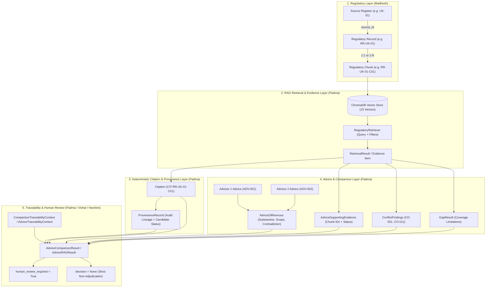

# WEEK 5 — TASK W5.8: REGULATORY ↔ ADVICE TRACEABILITY REPORT

---

## 1. Document Control

| Attribute | Specification |
| :--- | :--- |
| **Task Reference** | **WEEK 5 — TASK W5.8: Regulatory ↔ Advice Traceability** |
| **Document Version** | **1.0.0** |
| **Date** | **October 8, 2026** |
| **Role / Lead Author** | **Padma Kumar** — AI/RAG & Conflict Detection Engineer |
| **Project** | **ABC Shield / FinRegTech ShipYard AI/RAG** |
| **Collaborators** | **Madhesh** (Regulatory Data Lead), **Vishal** (Backend Lead), **Harshini** (Frontend Lead), **Sanjay** (API Gateway / Infrastructure Lead) |
| **Preceding Verified Baseline** | **604 / 604 Tests Passing** |
| **New Regression Baseline** | **628 / 628 Tests Passing (100.0% Pass Rate)** |
| **Corpus Invariant** | **15 Canonical Regulatory Records (15 Candidate / 0 Approved), ChromaDB = 15 Vectors** |
| **Status** | **COMPLETE** |

---

## 2. Objective & Mission

Task W5.8 implements, verifies, and formally documents the complete RAG-side **Regulatory → Advice Traceability Chain**.

### Core Question Answered:
> *"Why did RAG produce this finding for this advice?"*

The system enables any consumer (human auditor, backend audit log, frontend inspector) to trace every comparison stance, difference, conflict, and evidence gap back to the exact regulatory evidence chunks and official legislative sources used by RAG.

### Critical Governance Rule:
Traceability describes the **evidence backing** and **audit provenance**; it does **NOT** assert legal or professional correctness.
- It establishes: *"Source X was retrieved and provides factual context relevant to Advisor 1's position."*
- It strictly forbids: *"Because source X was retrieved, Advisor 1 is legally correct."*
- The final compliance determination remains strictly reserved for human compliance SMEs (`decision = None`).

---

## 3. End-to-End Traceability Diagram



---

## 4. Identifier Chain Mapping

The architecture links explicit, typed correlation identifiers across all 5 tiers:

| Tier | Identifier Name | Example Value | Description / Source |
| :--- | :--- | :--- | :--- |
| **Regulatory** | `source_id` | `UK-01` | Primary legislation in Source Register |
| **Regulatory** | `record_id` | `RR-UK-01` | Canonical normalized regulatory requirement record |
| **Regulatory** | `chunk_id` | `RR-UK-01-C01` | Specific discrete chunk embedded in ChromaDB |
| **Regulatory** | `chunk_index` / `total_chunks` | `0` / `1` | Positional offset within parent record |
| **RAG** | `request_id` | `REQ-CORRELATION-101` | Unique client/upstream request correlation ID |
| **RAG** | `citation_id` | `CIT-RR-UK-01-C01` | Deterministic citation referencing retrieved chunk |
| **Advice** | `advisor_advice_id` | `ADV-001` | Individual advisor advice note ID |
| **Advice** | `comparison_id` | `CMP-TRACE-909` | Pairwise comparison correlation ID |
| **Product** | `project_id` | `PRJ-WORKSPACE-42` | Workspace / tenant boundary |
| **Product** | `requirement_ids` | `["REQ-FIN-01"]` | Upstream product compliance requirement IDs |
| **Conflict** | `conflict_id` | `CO-001` | Pre-registered statutory relationship pair ID |

---

## 5. Tier-by-Tier Traceability Analysis

### 5.1. Regulatory Record → Chunk Traceability
- `RegulatoryRecordChunker.chunk_record()` maps a parent `NormalizedRegulatoryRecord` to one or more `RegulatoryChunk` models.
- Guarantees 100% preservation of `record_id`, `source_id`, `regulation`, `regulator`, `jurisdiction`, `section_article`, `title`, `topic`, `official_source`, `version_date`, `effective_date`, `validation_status`, `authority_level`, and `source_type`.
- Preserves chunk lineage via `chunk_id = f"{record_id}-C{idx+1:02d}"`, `chunk_index`, and `total_chunks`.

### 5.2. Chunk → Citation Traceability
- `CitationBuilder.build_citations()` generates `Citation` models strictly from retrieved `RetrievalResult` objects.
- Citations are deterministic: `citation_id = f"CIT-{chunk.chunk_id}"`.
- Formatted human-readable citation: `[{chunk_id} | {record_id} | {regulation} | {section_article}]`.
- Zero citation hallucination: If an evidence chunk was not retrieved from ChromaDB, it can never appear in citations.

### 5.3. Citation → Provenance Traceability
- Every `Citation` directly converts to a `ProvenanceRecord` preserving full audit lineage:
  `chunk_id`, `record_id`, `source_id`, `regulation`, `regulator`, `jurisdiction`, `section_article`, `title`, `official_source`, `version_date`, `effective_date`, `validation_status`, `is_approved_for_rag`, and `similarity_score`.
- Zero sensitive leaks: Internal disk file paths, API credentials, and vector store internal hashes are never exposed in provenance.

### 5.4. Advice → RAG Traceability (W5.4)
- [`AdviceRAGAdapter`](file:///d:/FInregTech%20Shipyard/abc-shield-ai/rag/pipeline/advice_adapter.py) packages inquiries into [`AdviceRAGResult`](file:///d:/FInregTech%20Shipyard/abc-shield-ai/rag/pipeline/advice_adapter.py#L48-L85).
- Provides `get_evidence_trace()` returning `request_id`, `project_id`, `requirement_ids`, `advisor_advice_ids`, `citations`, `provenance`, and `workflow_status`.

### 5.5. Comparison Traceability (W5.5)
- [`AdviceComparator`](file:///d:/FInregTech%20Shipyard/abc-shield-ai/rag/pipeline/advice_comparator.py) packages comparison between Advisor 1 and Advisor 2 into [`AdviceComparisonResult`](file:///d:/FInregTech%20Shipyard/abc-shield-ai/rag/pipeline/advice_comparator.py#L114-L188).
- Provides `get_evidence_trace_for_advice(advice_id)` mapping an advisor's advice note ID to its `supporting_chunk_ids`, `supporting_source_ids`, `evidence_status` (`SUPPORTED`, `PARTIALLY_SUPPORTED`, `INSUFFICIENT_EVIDENCE`), `citations`, and `provenance`.
- Provides `get_full_traceability_summary()` producing a complete correlation dictionary for audit logging and UI inspection.

### 5.6. Conflict & Relationship Traceability (W5.6)
- [`ConflictDetector`](file:///d:/FInregTech%20Shipyard/abc-shield-ai/rag/conflict/conflict_detector.py) surfaces registered relationships (`CO-001` through `CO-011`) when both sources are co-retrieved.
- `AdviceComparisonResult.get_conflict_trace(conflict_id)` maps a conflict finding back to its `retrieved_chunk_ids`, `source_id_1`, `source_id_2`, `citations`, and `provenance`.

### 5.7. Evidence Gap Traceability
- When a query references provisions outside the current ABC Shield corpus (e.g. Section 7 of the Bribery Act 2010), [`GapHandler`](file:///d:/FInregTech%20Shipyard/abc-shield-ai/rag/generation/gap_handler.py) produces a safe [`GapResult`](file:///d:/FInregTech%20Shipyard/abc-shield-ai/rag/generation/gap_handler.py#L32-L48).
- Traceability records `coverage_nature = "CORPUS_COVERAGE_LIMITATION"`, safely explaining evidence unavailability without claiming that the advisor's advice is legally wrong.

### 5.8. Approval State Traceability
- All 15 canonical records in `normalized_regulatory_records.json` are `Candidate - Awaiting Approval` (`is_approved_for_rag = False`).
- Traceability faithfully preserves this status across all chunks, citations, and provenance records.
- Fail-closed behavior: `filter_approved_only = True` returns 0 chunks and 0 citations.

### 5.9. Project & Tenant Isolation
- Passing a tenant `project_id` applies a strict metadata filter in ChromaDB (`where={"project_id": project_id}`).
- Unassigned or unauthorized project IDs return 0 chunks, guaranteeing zero cross-tenant evidence leakage.

---

## 6. Complete End-to-End Trace Example

Verified in automated test `test_w58_complete_end_to_end_trace`:

```
================================================================================
STEP 1: ADVICE INPUT
================================================================================
Advisor 1 ID:    ADV-E2E-001
Advisor 1 Text:  "Under Section 1 of the Bribery Act 2010, bribing another person is a statutory offence."

Advisor 2 ID:    ADV-E2E-002
Advisor 2 Text:  "Commercial organisations must implement proportionate procedures under Ministry of Justice Guidance."

Context:         comparison_id="CMP-E2E-TRACE", request_id="REQ-E2E-CORRELATION",
                 requirement_ids=["REQ-CORP-GOV-01"], jurisdiction="UK", regulatory_area="Anti-Bribery"

================================================================================
STEP 2: RAG RETRIEVAL & EVIDENCE MAPPING
================================================================================
Retrieved Chunk 1: RR-UK-01-C01 (similarity: 0.72)
Retrieved Chunk 2: RR-UK-02-C01 (similarity: 0.69)

Evidence Status (Advisor 1): SUPPORTED
Supporting Chunk IDs:        ["RR-UK-01-C01"]
Supporting Source IDs:       ["UK-01"]

================================================================================
STEP 3: CITATION & PROVENANCE GENERATION
================================================================================
Citation ID:         CIT-RR-UK-01-C01
Formatted Citation:  [RR-UK-01-C01 | RR-UK-01 | Bribery Act 2010 | Section 1]
Official Link:       https://www.legislation.gov.uk/ukpga/2010/23/contents

Provenance Record:
  Record ID:         RR-UK-01
  Source ID:         UK-01
  Regulation:        Bribery Act 2010
  Section:           Section 1
  Validation Status: Candidate - Awaiting Approval
  Approval Flag:     False

================================================================================
STEP 4: DOCUMENTED RELATIONSHIP EVALUATION
================================================================================
Conflict ID:         CO-001
Relationship:        Overlap - complementary
Conflict Type:       OVERLAP
Source Pair:         UK-01 (Bribery Act 2010) vs UK-02 (MoJ Guidance)
Message:             "Overlap - complementary. No direct conflict identified. No legal conflict resolution is made by this system."

================================================================================
STEP 5: COMPARISON RESULT & NON-ADJUDICATION
================================================================================
Human Review:        True (Mandatory due to candidate evidence and documented relationship)
Final Decision:      None (Strictly None; final determination reserved for human compliance SME)
Disclaimer:          "This comparison provides source-grounded regulatory analysis and factual difference identification... It does NOT determine which advisor is legally or professionally correct."
================================================================================
```

---

## 7. Verification Matrix: 24 Dedicated Tests

The test suite [`tests/test_regulatory_advice_traceability_w58.py`](file:///d:/FInregTech%20Shipyard/abc-shield-ai/tests/test_regulatory_advice_traceability_w58.py) covers all 24 required verification scenarios:

| # | Test Name | Target Behavior | Result |
| :---: | :--- | :--- | :---: |
| 1 | `test_w58_record_to_chunk_mapping` | Record ID, index, and total chunk count map deterministically to chunk | **PASSED** |
| 2 | `test_w58_chunk_to_source_mapping` | Retrieved chunk maps deterministically to parent source register ID | **PASSED** |
| 3 | `test_w58_retrieved_evidence_to_citation_mapping` | Citation model maps deterministically from retrieved chunk attributes | **PASSED** |
| 4 | `test_w58_citation_to_provenance_mapping` | Provenance record derives directly and faithfully from citation | **PASSED** |
| 5 | `test_w58_request_id_preservation` | Request ID is preserved across Advice RAG execution and comparison | **PASSED** |
| 6 | `test_w58_project_id_preservation` | Project ID is preserved cleanly in traceability metadata | **PASSED** |
| 7 | `test_w58_requirement_ids_preservation` | Requirement IDs pass through without alteration or loss | **PASSED** |
| 8 | `test_w58_advisor_1_id_preservation` | Advisor 1 ID is preserved across comparison traceability | **PASSED** |
| 9 | `test_w58_advisor_2_id_preservation` | Advisor 2 ID is preserved across comparison traceability | **PASSED** |
| 10 | `test_w58_comparison_id_preservation` | Comparison ID is preserved identically in result and traceability | **PASSED** |
| 11 | `test_w58_comparison_to_evidence_traceability` | `get_evidence_trace_for_advice()` maps advice ID to supporting chunks/citations | **PASSED** |
| 12 | `test_w58_conflict_to_regulatory_evidence_traceability` | `get_conflict_trace()` maps conflict ID to supporting chunks/citations | **PASSED** |
| 13 | `test_w58_evidence_gap_safe_traceability` | Evidence gap explains corpus limitation without asserting advisor is false | **PASSED** |
| 14 | `test_w58_approval_state_preserved` | Traceability preserves validation status and approval flag on all records | **PASSED** |
| 15 | `test_w58_candidate_evidence_remains_fail_closed` | `filter_approved_only=True` returns 0 chunks and 0 citations fail-closed | **PASSED** |
| 16 | `test_w58_zero_fabricated_citations` | Citations strictly reference retrieved evidence chunks | **PASSED** |
| 17 | `test_w58_zero_fabricated_provenance` | Provenance records strictly reference retrieved evidence chunks | **PASSED** |
| 18 | `test_w58_project_isolation_enforced` | Passing tenant project ID isolates vectors; zero cross-project leakage | **PASSED** |
| 19 | `test_w58_adapter_compatibility_and_trace` | AdviceRAGAdapter produces valid result with working `get_evidence_trace()` | **PASSED** |
| 20 | `test_w58_comparator_compatibility_and_trace` | AdviceComparator produces valid comparison with working trace method | **PASSED** |
| 21 | `test_w58_conflict_compatibility_and_trace` | AdviceComparator preserves registered relationships with working trace | **PASSED** |
| 22 | `test_w58_regulatory_boundary_compatibility` | Canonical JSON records on disk remain unchanged after traceability queries | **PASSED** |
| 23 | `test_w58_w411_wire_compatibility` | GroundedGenerator output satisfies the locked W4.11 contract | **PASSED** |
| 24 | `test_w58_complete_end_to_end_trace` | Verifies the entire end-to-end chain from advice IDs to regulatory record | **PASSED** |

---

## 8. Full Regression Results

Execution of the full automated test suite:

```powershell
$env:HF_HUB_OFFLINE='1'; & "d:\FInregTech Shipyard\.venv\Scripts\python.exe" -m pytest -q
........................................................................ [ 11%]
........................................................................ [ 22%]
........................................................................ [ 34%]
........................................................................ [ 45%]
........................................................................ [ 57%]
........................................................................ [ 68%]
........................................................................ [ 80%]
........................................................................ [ 91%]
....................................................                     [100%]
628 passed in 33.89s
```

- **Preceding Baseline**: 604 passed
- **New Tests Added**: 24 passed
- **Total Passing Tests**: **628 passed, 0 failures, 0 errors (100.0% pass rate)**

---

## 9. Security & Corpus Integrity Invariants

1. **Zero Corpus Mutation**: Raw Excel workbooks, `normalized_regulatory_records.json`, and `regulatory_chunks.json` remain bitwise unchanged.
2. **ChromaDB Stability**: Exactly 15 vectors preserved. Zero re-indexing or re-embedding.
3. **Approval Gating**: 15 records remain Candidate / 0 Approved. Gating strictly fails closed.
4. **Tenant Isolation**: Vectors are scoped by `project_id`. Client metadata cannot forge tenant boundaries.
5. **No Hallucinated Citations**: Citations and provenance are constructed 100% deterministically from vector store hits outside the LLM.

---

## 10. Ownership Boundaries & Dependencies

### Padma (Completed):
- Implemented and verified the complete Regulatory $\to$ Advice traceability chain.
- Added trace navigation helpers `get_evidence_trace_for_advice()`, `get_conflict_trace()`, and `get_full_traceability_summary()`.
- Added 24 automated tests bringing regression baseline to 628/628 passing.

### Madhesh Dependencies:
- Canonical source registers and workbook metadata maintenance.
- Future SME approval process to promote Candidate records to Approved in source registers.

### Vishal Dependencies:
- Backend persistence for comparison sessions (`comparison_id`) and advisor advice records.
- Authenticated user and tenant authorization before passing `project_id` to RAG.
- Storing human compliance SME decisions when adjudicating comparisons.

### Harshini Dependencies:
- Interactive frontend display of citations and audit provenance drawers.
- UI display of `evidence_status` and supporting chunk badges per advisor.
- Side-by-side display of conflict findings and non-adjudication disclaimers.
