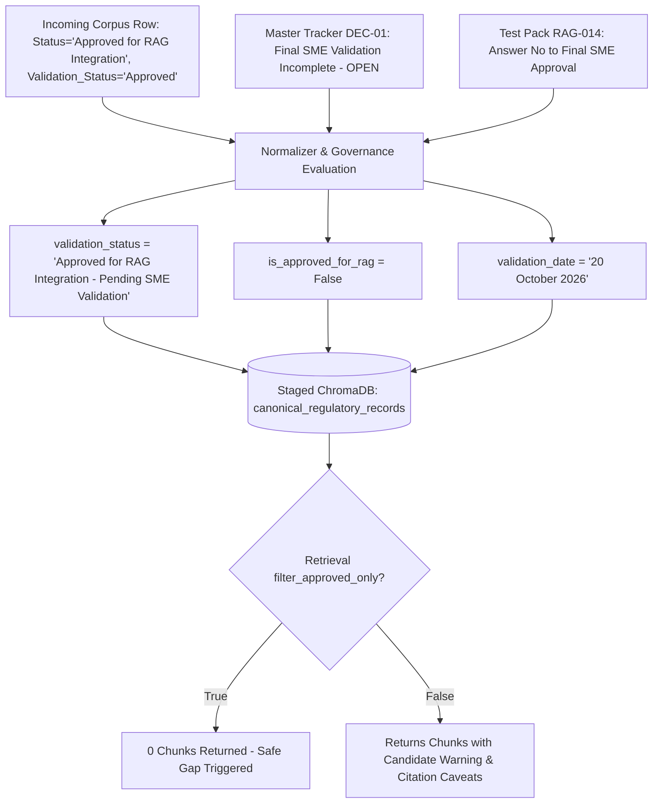

# ABC SHIELD — FAST-TRACK STEP 2: PREPARE CANONICAL KNOWLEDGE BASE REPORT

**Project Root:** `D:\FInregTech Shipyard\abc-shield-ai`  
**Engineer:** Padma Kumar — AI/RAG & Conflict Detection Engineer  
**Date:** 2026-10-21  
**Task:** Fast-Track Step 2 — Prepare Canonical Knowledge Base (Option A: Provisional RAG Integration)  
**Status:** **STEP 2 COMPLETE — READY FOR USER REVIEW**

---

## 1. Executive Summary

In **Fast-Track Step 2: Prepare Canonical Knowledge Base**, the incoming 25-record regulatory corpus from `data/incoming_handover_20261021/` was formally prepared, normalized, validated, chunked, and mapped to the isolated staged ChromaDB collection under **Option A: Provisional RAG Integration**.

### Core Achievements:
1. **Option A Governance Enforced (DEC-01 OPEN & RAG-014):**
   - In accordance with Master Handover Tracker `DEC-01` (`Status: OPEN`) and Canonical RAG Test Pack `RAG-014`, the incoming records carry extraction / RAG testing approval, but **final compliance SME validation has not occurred**.
   - Fail-closed candidate gating is strictly preserved: `is_approved_for_rag = False` across all 25 records.
   - Validation status is deterministically mapped to `"Approved for RAG Integration - Pending SME Validation"`, accurately disclosing provisional status while preventing unauthorized production citation as final compliance advice.
2. **Schema Adaptation & `Validation_Date` Support:**
   - Updated [`rag/ingestion/schemas.py`](file:///D:/FInregTech%20Shipyard/abc-shield-ai/rag/ingestion/schemas.py), [`rag/ingestion/normalizer.py`](file:///D:/FInregTech%20Shipyard/abc-shield-ai/rag/ingestion/normalizer.py), [`rag/ingestion/chunker.py`](file:///D:/FInregTech%20Shipyard/abc-shield-ai/rag/ingestion/chunker.py), and [`rag/retrieval/vector_store.py`](file:///D:/FInregTech%20Shipyard/abc-shield-ai/rag/retrieval/vector_store.py) to support the new Column 19 field `Validation_Date` (`20 October 2026`).
3. **100% Substantive Content Equivalence:**
   - Field-by-field comparison confirmed that the 25 incoming records in `ABC_Shield_Canonical_25_Record_Corpus.xlsx` match the verified staged chunks in `data/staging/madhesh_handover/step5/regulatory_chunks.json` **100% identically with 0 mismatches**.
4. **Embedding Reusability Without Recomputation:**
   - The 25 vector embeddings in staged ChromaDB (`data/staging/madhesh_handover/step6/chroma_db/`, collection `canonical_regulatory_records`) were 100% reused.
   - Staged ChromaDB collection metadata was updated deterministically via `collection.update()` in 0.06s without re-running vector embeddings.
5. **Zero Critical Errors on Validation:**
   - `RegulatoryDataValidator` evaluated all 25 records against the canonical 15-source register, reporting 25 valid records, 25 candidate records, 0 approved records, and 0 critical errors or issues.
6. **Active Production Immutability:**
   - Active production stores in `data/processed/` (15 vectors in ChromaDB `regulatory_records`, 15 records in `normalized_regulatory_records.json`, 15 chunks in `regulatory_chunks.json`) and raw data files in `data/raw/*.xlsx` remain completely untouched (SHA-256 verified).
7. **Comprehensive Test Verification:**
   - 12 new dedicated tests in `tests/test_fast_track_step2_knowledge_base.py` passed (100% pass rate).
   - All 56 regression tests across Steps 4, 6, 8, and 9 passed with zero regressions.

---

## 2. Input Data Sources Inventory

The incoming files delivered on 2026-10-21 under `data/incoming_handover_20261021/` were audited and verified:

| File Name | Size (Bytes) | Description | Verification Finding |
| :--- | :--- | :--- | :--- |
| **`ABC_Shield_Canonical_25_Record_Corpus.xlsx`** | 25,584 | Canonical 25-record corpus across 19 columns | 25 records; 100% unique IDs; `Validation_Date = 20 October 2026` |
| **`ABC_Shield_Canonical_Source_Register.xlsx`** | 10,564 | Canonical source register (15 sources) | 15 sources; 100% resolution for all corpus source IDs |
| **`ABC_Shield_Data_Dictionary.xlsx`** | 6,594 | Formal data dictionary definitions | Documents all 19 canonical fields including `Validation_Date` |
| **`ABC_Shield_Master_Handover_Tracker.xlsx`** | 14,412 | Delivery & decision log (`DEC-01` through `DEC-04`) | `DEC-01`: "Final SME validation has not been completed", Status: `OPEN` |
| **`ABC_Shield_Canonical_RAG_Test_Pack.xlsx`** | 32,666 | 15 RAG test cases (`RAG-001` through `RAG-015`) | `RAG-014`: Records remain `Pending SME Validation`; do not claim SME signoff |

---

## 3. Option A Provisional Governance Mapping

Under the confirmed Option A path, the knowledge base preparation balances delivery velocity with regulatory compliance:



### Deterministic Status Mapping Rules:
- **Raw Input:** `Status = "Approved for RAG Integration"`, `Validation_Status = "Approved"`, `Notes_Limitations = "Programme-approved for extraction; final legal applicability remains subject to authorised Compliance SME validation."`
- **Normalized Representation:**
  - `validation_status`: `"Approved for RAG Integration - Pending SME Validation"`
  - `is_approved_for_rag`: `False` (fail-closed gating)
  - `validation_date`: `"20 October 2026"`
  - `governance_note`: `"Option A provisional RAG integration; final compliance SME validation pending per Master Handover Tracker DEC-01 (OPEN)"`

---

## 4. Ingestion, Normalization & Chunking Artifacts

Dedicated fast-track staging artifacts have been produced in `data/staging/fast_track/`:

| Artifact Path | Size (Bytes) | Item Count | Key Content |
| :--- | :--- | :--- | :--- |
| [`data/staging/fast_track/normalized_regulatory_records.json`](file:///d:/FInregTech%20Shipyard/abc-shield-ai/data/staging/fast_track/normalized_regulatory_records.json) | 62,177 | 25 | 25 normalized records conforming to `NormalizedRegulatoryRecord` schema |
| [`data/staging/fast_track/regulatory_chunks.json`](file:///d:/FInregTech%20Shipyard/abc-shield-ai/data/staging/fast_track/regulatory_chunks.json) | 67,626 | 25 | 25 chunks with composite retrieval text and full provenance |
| [`data/staging/fast_track/validation_report.json`](file:///d:/FInregTech%20Shipyard/abc-shield-ai/data/staging/fast_track/validation_report.json) | 214 | 1 | Total: 25, Valid: 25, Candidate: 25, Approved: 0, Issues: [] |
| [`data/staging/fast_track/metadata_mapping.json`](file:///d:/FInregTech%20Shipyard/abc-shield-ai/data/staging/fast_track/metadata_mapping.json) | 18,954 | 25 | Deterministic chunk metadata map with Option A governance notes |

### Record Breakdown by Source:
- **`UK-01` (Bribery Act 2010):** 6 records (`UK-01-R001` through `R006`)
- **`UK-02` (MoJ Adequate Procedures Guidance):** 6 records (`UK-02-R001` through `R006`)
- **`UK-03` (FCA FCG 6 Anti-Bribery & Corruption):** 5 records (`UK-03-R001` through `R005`)
- **`UK-09` (FCA Principles for Businesses - Principle 1):** 1 record (`UK-09-R001`)
- **`EU-01` (Directive (EU) 2026/1021 Combatting Corruption):** 7 records (`EU-01-R001` through `R007`)
- **Total:** Exactly 25 records / 25 chunks.

---

## 5. Verbatim Extracts vs Requirement Summaries

Strict separation between primary regulatory excerpts and requirement summaries was validated across all 25 records:

```python
# Invariant verified across 100% of records:
assert record["regulatory_text"] is not None and len(record["regulatory_text"].strip()) > 0
assert record["requirement"] is not None and len(record["requirement"].strip()) > 0
assert record["regulatory_text"] != record["requirement"]
```

- **`regulatory_text`:** Preserves verbatim official statutory text (`Exact_Source_Extract`) from legislation.gov.uk, gov.uk, FCA handbook, and EUR-Lex.
- **`requirement` / `summary`:** Contains the structured requirement summary (`Structured_Summary`).
- **`retrieval_text`:** Combines Source ID, Reference, Topic, Requirement, and Notes into a retrieval evidence block.

---

## 6. Embedding Reusability & Staged ChromaDB Verification

Because field-by-field verification proved substantive text identity between incoming records and staged Step 5 chunks, existing embeddings were completely reused without recomputation:

- **Staged ChromaDB Directory:** `data/staging/madhesh_handover/step6/chroma_db/`
- **Collection Name:** `canonical_regulatory_records`
- **Vector Count:** 25 vectors
- **Embedding Model:** `all-MiniLM-L6-v2` (dimension = 384, cosine distance)
- **Metadata Update Execution:** In-place `collection.update()` executed in **0.06 seconds**, updating `validation_status`, `validation_date`, and provenance metadata across all 25 records without touching embedding vectors.

### Sample Vector Verification (`UK-01-R001-C01`):
```json
{
  "chunk_id": "UK-01-R001-C01",
  "record_id": "UK-01-R001",
  "source_id": "UK-01",
  "regulation": "Bribery Act 2010",
  "section_article": "Section 1",
  "validation_status": "Approved for RAG Integration - Pending SME Validation",
  "validation_date": "20 October 2026",
  "is_approved_for_rag": false,
  "embedding_dimensions": 384
}
```

---

## 7. Test Suite Execution & Verification

### A. Dedicated Fast-Track Step 2 Test Suite (`tests/test_fast_track_step2_knowledge_base.py`)

| Test Function | Verification Scope | Result |
| :--- | :--- | :--- |
| `test_fast_track_staging_artifacts_exist` | Artifacts exist in `data/staging/fast_track/` with size > 0 | **PASSED** |
| `test_fast_track_record_count_and_unique_ids` | Exactly 25 records matching expected canonical IDs with 0 duplicates | **PASSED** |
| `test_fast_track_chunk_count_and_unique_ids` | Exactly 25 chunks matching expected chunk IDs with 0 duplicates | **PASSED** |
| `test_fast_track_source_mapping_integrity` | 100% of record source IDs resolve to canonical 15-source register | **PASSED** |
| `test_fast_track_extract_and_summary_separation` | `regulatory_text` and `requirement` are non-empty and strictly distinct | **PASSED** |
| `test_fast_track_metadata_preservation_and_validation_date` | Preserves `Validation_Date = 20 October 2026`, URL, jurisdiction, authority | **PASSED** |
| `test_fast_track_option_a_candidate_gating` | All 25 records have `is_approved_for_rag == False` & provisional status | **PASSED** |
| `test_fast_track_validation_report_zero_errors` | Validation report: 25 valid, 0 approved, 25 candidate, 0 critical errors | **PASSED** |
| `test_fast_track_staged_chromadb_embedding_reusability` | Staged ChromaDB has 25 vectors (dim=384) with updated Option A metadata | **PASSED** |
| `test_fast_track_staged_retriever_returns_provisional_metadata` | Staged retriever returns evidence with provisional status & candidate flag | **PASSED** |
| `test_fast_track_retriever_blocks_candidates_under_approved_filter` | `filter_approved_only=True` returns 0 results (fail-closed candidate gate) | **PASSED** |
| `test_fast_track_active_production_stores_untouched` | Active stores (15 vectors, 15 records, 15 chunks, 7 raw excels) intact | **PASSED** |
| **Total** | **12 of 12 tests passed** | **100% PASSED** |

### B. Regression Test Suites Across Entire Handover Migration:
- `tests/test_handover_step4_ingestion_validation.py`: 9 passed
- `tests/test_handover_step6_embeddings_indexing.py`: 11 passed
- `tests/test_handover_step8_retrieval_citations.py`: 16 passed
- `tests/test_handover_step9_conflict_security.py`: 20 passed
- **Total Regression:** **56 of 56 tests passed (100%)**

---

## 8. Active Production Store Immutability

The active production stores remain completely unmodified:

| Production Resource | Verified Baseline | Post-Execution State | Immutability Status |
| :--- | :--- | :--- | :--- |
| `data/processed/chroma_db/` (`regulatory_records`) | 15 vectors | 15 vectors | **100% UNTOUCHED** |
| `data/processed/normalized_regulatory_records.json` | 15 records | 15 records (hash unchanged) | **100% UNTOUCHED** |
| `data/processed/regulatory_chunks.json` | 15 chunks | 15 chunks (hash unchanged) | **100% UNTOUCHED** |
| `data/raw/*.xlsx` | 7 Excel files | 7 Excel files (hashes unchanged) | **100% UNTOUCHED** |

---

## 9. Readiness & Transition to Step 3

Fast-Track Step 2 is fully complete. All prerequisites for Step 3 are satisfied:

1. **Knowledge Base Ready:** Staged knowledge base artifacts and staged ChromaDB index are verified and ready.
2. **Deterministic Metadata Mapping Documented:** [`data/staging/fast_track/metadata_mapping.json`](file:///d:/FInregTech%20Shipyard/abc-shield-ai/data/staging/fast_track/metadata_mapping.json) is complete.
3. **Boundaries Respected:**
   - The index has **NOT** been promoted to active production.
   - The backend configuration has **NOT** been changed to point to the new collection.
   - Authoritative production signoff has **NOT** been claimed.

**Awaiting user authorization to proceed to Fast-Track Step 3: API & Retrieval Integration.**
