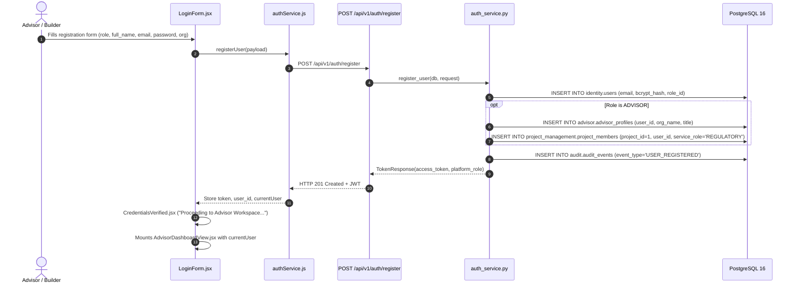
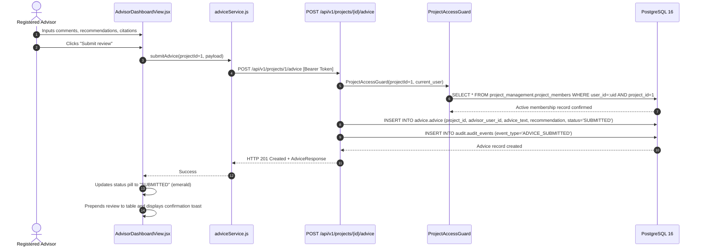

# FRONTEND–BACKEND–DATABASE TRACEABILITY SPECIFICATION
## FinRegTech ShipYard | FCC Project Cockpit
**Application:** ABC Shield Prototype
**Auditor:** Lead System Architect & Database Integration Specialist
**Verification Date:** October 14, 2026
**Status:** 100% End-to-End Traced & Verified

---

### Architectural Overview

FinRegTech ShipYard enforces strict multi-schema isolation, robust API contracts, and cryptographic persistence across all tiers:

```
[ Frontend: React 19 / Vite 8 ]
         │
         │  HTTP / JSON + Bearer JWT
         â–¼
[ Backend: FastAPI 0.115 / Uvicorn ]
         │
         │  Dependency Injection & RBAC (ProjectAccessGuard)
         â–¼
[ Service Layer: SQLAlchemy 2.0 ORM ]
         │
         │  psycopg2 Connection Pool
         â–¼
[ Database: PostgreSQL 16 ("FinRegTech ShipYard") ]
   ├── identity (users, roles)
   ├── project_management (projects, profiles, members)
   ├── regulatory (sources, requirements)
   ├── advice (advisory reviews)
   ├── decision (builder decisions)
   ├── advisor (advisor profiles, invitations)
   └── audit (audit_events)
```

---

### End-to-End Traceability Flows

#### 1. User Registration & Immediate Workspace Assignment


- **Frontend Origin:** `frontend/src/components/LoginForm.jsx` → `frontend/src/services/authService.js:registerUser`
- **Backend API:** `POST /api/v1/auth/register` in `backend/app/api/v1/auth.py`
- **Service Handler:** `register_user()` in `backend/app/services/auth_service.py`
- **PostgreSQL Schemas & Tables:**
  - `identity.users`: Stores `user_id`, `email`, `password_hash` (bcrypt), `full_name`, `role_id`, `is_active`.
  - `advisor.advisor_profiles`: Automatically populated for advisors with organizational details and professional title.
  - `project_management.project_members`: Newly registered advisors are immediately enrolled into demonstrator Project 1 (`PRJ-ABC-001`) with service role `REGULATORY`.
  - `audit.audit_events`: Platform-level audit event recorded with actor ID and registration details.

---

#### 2. Authentication & Session Establishment
- **Frontend Origin:** `frontend/src/components/LoginForm.jsx` → `frontend/src/services/authService.js:loginUser`
- **Backend API:** `POST /api/v1/auth/login` in `backend/app/api/v1/auth.py`
- **Service Handler:** `authenticate_user()` in `backend/app/services/auth_service.py`
- **Security Check:** Verifies plain-text candidate against bcrypt hash using `passlib.context.CryptContext` (`schemes=["bcrypt"]`). Checks `is_active == True`.
- **Token Generation:** Signs RS256/HS256 JWT containing `sub` (`user_id`), `email`, `full_name`, and `platform_role`.
- **Database Query:**
  ```sql
  SELECT u.user_id, u.email, u.password_hash, u.is_active, r.role_name
  FROM identity.users u
  JOIN identity.roles r ON u.role_id = r.role_id
  WHERE u.email = :clean_email;
  ```

---

#### 3. Advisory Review Submission & Project Isolation


- **Frontend Origin:** `frontend/src/components/AdvisorDashboardView.jsx:handleSubmitReview`
- **Backend API:** `POST /api/v1/projects/{projectId}/advice` in `backend/app/api/v1/advice.py`
- **Authorization Guard:** `ProjectAccessGuard` in `backend/app/security/authorization.py` strictly verifies `project_management.project_members` membership.
- **Service Handler:** `submit_advice()` in `backend/app/services/advice_service.py`
- **PostgreSQL Schemas & Tables:**
  - `advice.advice`: Primary key `advice_id`, foreign keys to `projects.project_id` and `identity.users.user_id`, text content, citations, and status `'SUBMITTED'`.
  - `audit.audit_events`: Audit log written with `event_type="ADVICE_SUBMITTED"`.

---

#### 4. Live Notifications & Audit Provenance
- **Frontend Origin:** `AdvisorDashboardView.jsx` & `DashboardView.jsx` `useEffect` → `authService.js:getUserNotifications`
- **Backend API:** `GET /api/v1/users/me/notifications` in `backend/app/api/v1/users.py`
- **Service Logic:**
  1. Queries pending advisor invitations from `advisor.advisor_invitations` for user email.
  2. Queries recent audit events from `audit.audit_events` strictly filtered by projects where the user is an active member in `project_management.project_members`.
- **Database Query:**
  ```sql
  SELECT a.audit_event_id, a.event_type, a.event_description, a.project_id, a.created_at
  FROM audit.audit_events a
  WHERE a.project_id IN (
      SELECT pm.project_id
      FROM project_management.project_members pm
      WHERE pm.user_id = :current_user_id AND pm.member_status = 'ACTIVE'
  )
  ORDER BY a.created_at DESC
  LIMIT 15;
  ```

---

#### 5. Authenticated Password Modification
- **Frontend Origin:** `frontend/src/components/SettingsView.jsx:handleChangePassword`
- **Backend API:** `POST /api/v1/auth/change-password` in `backend/app/api/v1/auth.py`
- **Service Handler:** `change_user_password()` in `backend/app/services/auth_service.py`
- **PostgreSQL Schemas & Tables:**
  - Verifies current bcrypt password in `identity.users`.
  - Computes new bcrypt hash (`rounds=12`) and updates `identity.users.password_hash` and `updated_at`.
  - Creates audit event in `audit.audit_events` with `event_type="USER_PASSWORD_CHANGED"`.

---

### Referential Integrity Guarantees

All tables enforce PostgreSQL relational foreign keys with strict cascade definitions:
1. `projects.created_by` → `identity.users.user_id` (RESTRICT)
2. `project_members.project_id` → `projects.project_id` (CASCADE)
3. `project_members.user_id` → `identity.users.user_id` (CASCADE)
4. `regulatory_requirements.project_id` → `projects.project_id` (CASCADE)
5. `regulatory_requirements.regulatory_source_id` → `regulatory_sources.regulatory_source_id` (RESTRICT)
6. `advice.project_id` → `projects.project_id` (CASCADE)
7. `advice.advisor_user_id` → `identity.users.user_id` (RESTRICT)
8. `audit_events.actor_user_id` → `identity.users.user_id` (RESTRICT)
9. `advisor_profiles.user_id` → `identity.users.user_id` (CASCADE)
